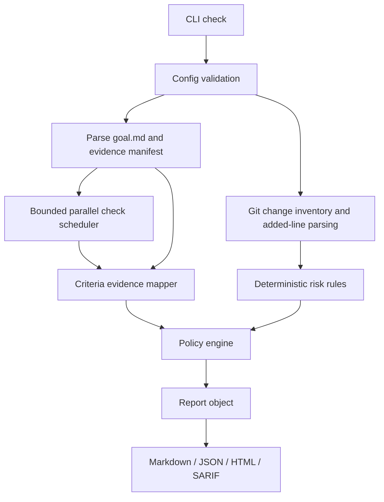

# Architecture — CodeBridge Pro Beta v0.2

## Runtime flow

## Directory responsibilities

- `src/cli`: terminal interface for `init`, `doctor`, `check`, `explain`, `compare`.
- `src/core/config.ts`: strict config validation and defaults.
- `src/core/types.ts`: shared report contract (schema 1.1).
- `src/core/orchestrator.ts`: stage coordination and output emission.
- `src/git/diff.ts`: Git name-status, numstat, local/untracked files, and added-line extraction.
- `src/checks/runner.ts`: subprocess lifecycle, timeout, output truncation, allowlist.
- `src/checks/scheduler.ts`: bounded concurrency with deterministic result order.
- `src/intent/parser.ts`: Markdown goal criteria; optionally stable IDs.
- `src/intent/evidence.ts`: conservative mapping of known checks and context files.
- `src/analysis/rules.ts`: deterministic heuristic findings for added lines and touched files.
- `src/core/policy.ts`: pass/review/fail and strict exit semantics.
- `src/reports/`: serialization, HTML dashboard, SARIF, and report comparison.
- `src/utils/paths.ts`: lexical path and symlink traversal guard for supplied paths.

## Verification invariants

1. A global passing suite is *not* enough to verify an individual criterion.
2. A changed source file is context, not behavioral proof.
3. For criterion-specific checks, all mapped checks must pass to return `verified`.
4. A failure of any mapped check produces `conflict` (regardless of others passing).
5. Heuristic static findings cannot upgrade verification status.
6. `review` is not the same as `pass`, even when default exit code is 0.
7. All command arguments are arrays executed with `shell:false`; scripts are still repository-controlled code.

## Trade-offs & design boundaries

- **No AI:** avoids unverifiable claims and cost, but linking tests to requirements remains explicit/manual.
- **No AST:** low complexity and language independence, but only catches token patterns in new lines.
- **No runtime dependencies:** compiled binary works with Node 20+; development still needs TypeScript and Node types.
- **Parallel checks:** faster for independent scripts, but can create resource contention; set concurrency to 1 for stateful checks.
- **SARIF:** covers deterministic findings only. GitHub code scanning upload (if enabled by maintainers) is a separate CI permission concern.
- **Git diff:** includes HEAD committed delta + worktree + untracked, and may double-count statistics if the same line appears in both patches. Such counters are advisory.
- **Security:** symlink rejection applies to selected configuration/input/output paths. Source repository scripts must never be trusted merely because CodeBridge launches them.

## Suggested roadmap for v0.3

1. Cross-platform command execution and safe environment isolation.
2. Structured test adapters (Jest/Vitest/JUnit coverage and case-level attribution).
3. Evidence provenance, versioned configuration migrations, and signed attestation support.
4. `--changed-only` incremental mode with cache keyed by diff+check command.
5. Controlled plugin API with sandbox boundaries and deterministic built-in rules.
6. PR comments/GitHub check annotations using read-only workflows and minimal permissions.
